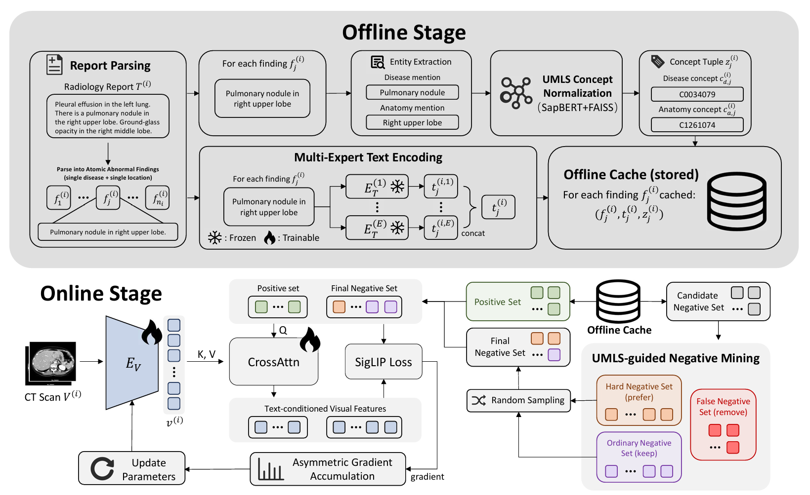

# ECT-CLIP: Resource-Efficient CT Vision-Language Pretraining via Negative Scaling

<p align="left">
  <a href="https://2026.emnlp.org/"></a>
  <a href="#citation"></a>
  <a href="LICENSE"></a>
</p>

This is the official implementation of our **EMNLP 2026** paper:

> **ECT-CLIP: Resource-Efficient CT Vision-Language Pretraining via Negative Scaling**

## 📖 Overview

ECT-CLIP is a resource-efficient vision-language pretraining framework for 3D chest CT.
<p align="center"></p>

## 🔥 News

- **[2026.08]** Our paper has been accepted to **EMNLP 2026**! 🎉
- **[2026.08]** Code is released. Model checkpoints and pre-computed offline data will be released soon.

## 🛠️ Installation

```bash
git clone https://github.com/<your-username>/ECT-CLIP.git
cd ECT-CLIP

conda create -n ectclip python=3.10 -y
conda activate ectclip

pip install torch torchvision
pip install monai transformers scikit-learn pandas numpy tqdm swanlab
# Optional, only needed if you use the MedCLIP text encoder:
# pip install medclip
```

## 📂 Data Preparation

### 1. CT-RATE dataset

ECT-CLIP is trained and evaluated on [CT-RATE](https://huggingface.co/datasets/ibrahimhamamci/CT-RATE). Please download the dataset from its official source, and pre-process the raw CT volumes with the scripts provided by [fvlm](https://github.com/alibaba-damo-academy/fvlm/tree/main/data). Then organize the data as follows:

- `data_folder`: pre-processed training volumes, organized as `<patient_id>/<accession_id>/*.nii.gz`
- `labels_csv`: multi-abnormality labels (e.g. `train_predicted_labels.csv`), with a `VolumeName` column followed by one column per pathology
- `reports_csv` (evaluation only): validation reports with `VolumeName`, `Findings_EN` and `Impressions_EN` columns

### 2. Offline-stage data

All text-side artifacts are pre-computed offline. Please download the `offline_stage_data/` folder from [Baidu Netdisk](https://pan.baidu.com/s/xxxxxxxx) and place it in the root of this repository.

## 📁 Repository Structure

```
ECT-CLIP/
├── models/ectclip.py            # ECTCLIP model (3D ResNet-18 + cross-attention) and SigLIP loss
├── datasets/training_dataset.py # CT-RATE dataset with random / hard negative sampling
├── train_ectclip.py             # Training script
├── eval_ectclip.py              # Zero-shot evaluation on CT-RATE
├── calc_metrics.py              # Metric computation (AUC, ACC, Spec, Sens, F1, Prec)
└── offline_stage_data/          # Pre-computed text-side artifacts
```

## 🚀 Training

Edit the config at the bottom of `train_ectclip.py` (mainly `data_folder` and `labels_csv`), then run:

```bash
python train_ectclip.py
```

## 🔍 Zero-shot Evaluation

Zero-shot multi-label classification on the CT-RATE validation set with prompt ensembling (13 prompt templates × 16 pathologies):

```bash
python eval_ectclip.py \
  --checkpoint path/to/checkpoint.pt \
  --data_folder path/to/ctrate/valid_images \
  --labels_csv path/to/valid_predicted_labels.csv \
  --reports_csv path/to/valid_reports.csv \
  --save_dir ./results
```

Per-prompt prediction CSVs are written to `--save_dir`.

### Metrics

After evaluation, compute the zero-shot metrics (AUC, ACC, Spec, Sens, F1, Prec) following fVLM's evaluation protocol:

```bash
python calc_metrics.py \
  --csv_file ./results/ctrate_prompt_version_0.csv \
  --labels_csv path/to/valid_predicted_labels.csv
```

Replace `ctrate_prompt_version_0.csv` with any of the per-prompt prediction files, or average the probabilities across prompts beforehand for the prompt-ensembled result.

## 🙏 Acknowledgements

We thank the authors of the [CT-RATE](https://huggingface.co/datasets/ibrahimhamamci/CT-RATE) dataset, and the authors of [CXR-BERT](https://huggingface.co/microsoft/BiomedVLP-CXR-BERT-specialized), [BioLORD](https://huggingface.co/FremyCompany/BioLORD-2023), [RadBERT](https://huggingface.co/zzxslp/RadBERT-RoBERTa-4m) and [MedCLIP](https://github.com/RyanWangZf/MedCLIP) for releasing their text encoders. This work was supported by the National Natural Science Foundation of China (U22B2061), the National Key R\&D Program of China (2022YFB4300603), and Natural Science Foundation of Sichuan, China (2026NSFSC0429).

## ✍️ Citation

If you find this work useful, please consider citing:
```bibtex
@inproceedings{ectclip2026,
  title     = {ECT-CLIP: Resource-Efficient CT Vision-Language Pretraining via Negative Scaling},
  author    = {Hanwen Zhang, Yao Liu, Jiaye Yang, Die Dai, Qiao Liu, Yutong Xie, Peng Wang },
  booktitle = {Proceedings of the 2026 Conference on Empirical Methods in Natural Language Processing (EMNLP)},
  year      = {2026}
}
```

## 📄 License

This project is released under the [Apache 2.0 License](LICENSE).
